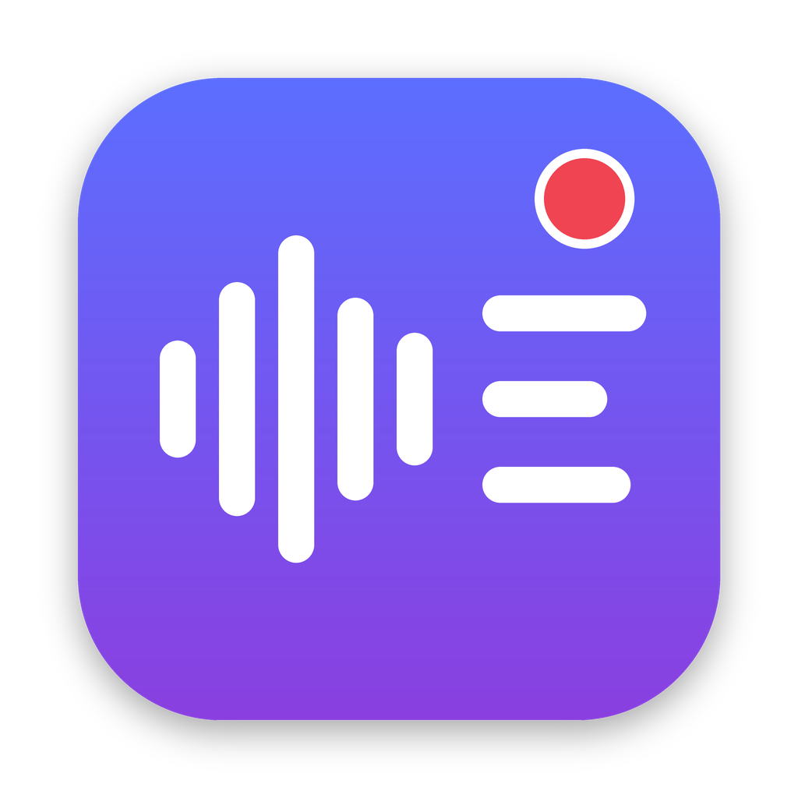

<p align="center">
  
</p>

<h1 align="center">Psiu</h1>

<p align="center">
  Grave e transcreva suas reuniões <b>sem bot entrando na chamada</b>.<br>
  macOS e Windows · Português e inglês · Identificação de quem fala
</p>

---

O Psiu grava **o seu microfone** e **o som do computador** direto do sistema, do mesmo jeito que o Audacity
grava "o que sai da placa de som". Funciona com Google Meet, Zoom, Teams, Slack ou qualquer outra coisa, e
ninguém vê um "Notetaker" entrando na reunião. No fim, você recebe um transcript com os falantes separados,
pronto para colar no Claude (ou outra IA) e pedir um resumo, uma lista de tarefas ou um brainstorm.

## Recursos

- **Sem bot**: captura local do áudio do sistema (ScreenCaptureKit no macOS, WASAPI loopback no Windows).
- **"Eu" sempre identificado**: microfone e sistema são gravados em trilhas separadas; só as outras vozes
  passam pela separação de falantes.
- **PT, EN ou misturado**, com separação de falantes, via [Deepgram](https://deepgram.com) (Nova-3).
- **Atalhos globais**, com o app minimizado: `⌃⌥R` / `Ctrl+Alt+R` grava e para; `⌃⌥M` / `Ctrl+Alt+M`
  marca um momento importante. Um som confirma cada ação.
- **Medidor de volume** ao vivo das duas trilhas (avisa se algo está mudo).
- **⭐ Marcar momentos** durante a reunião, destacados no transcript.
- **Renomear falantes** ("Pessoa 1" → "Ana") em todo o transcript.
- **Copiar com prompt**: resumo e decisões, lista de tarefas, brainstorm ou e-mail de follow-up, com ou sem
  horários.
- Histórico com busca, título editável e custo estimado de cada gravação.

## Custo

O Psiu é gratuito; você usa a sua própria chave da Deepgram. O preço do Nova-3 multilíngue para áudio
gravado é de cerca de **US$ 0,0052/min por trilha**, ou seja, **~US$ 0,60 por hora de reunião** (duas
trilhas). Confira os valores atuais em [deepgram.com/pricing](https://deepgram.com/pricing). Contas novas
costumam ganhar créditos grátis.

## Instalação

**Baixe pronto** na página de [Releases](https://github.com/railima/psiu/releases): `Psiu.exe` (Windows) ou
`Psiu.dmg` (macOS 15+). Ou compile você mesmo:

### macOS (15 ou mais recente)

Requer as Xcode Command Line Tools (`xcode-select --install`) e o [uv](https://docs.astral.sh/uv/).

```sh
./build_mac.sh        # gera dist/Psiu.app e dist/Psiu.dmg
```

Abra o `.dmg` e arraste o Psiu para Aplicativos. Como o app não é assinado pela Apple, na primeira vez
clique com o botão direito → **Abrir**. Na primeira gravação, permita **Microfone** e **Gravação de Tela e
Áudio do Sistema** em Ajustes → Privacidade e Segurança, e reabra o app.

### Windows 11

Instale o Python (`winget install Python.Python.3.12`), baixe este repositório e dê dois cliques em
`build_windows.bat`. Ele gera `dist\Psiu.exe`, um executável único que você pode guardar onde quiser.
O SmartScreen pode avisar na primeira execução: **Mais informações → Executar assim mesmo**.

Opcional: `winget install ffmpeg` faz o Psiu comprimir o áudio antes do envio (upload ~8x menor).

## Uso

1. Abra o Psiu e cole a sua API key da Deepgram ([console.deepgram.com](https://console.deepgram.com) →
   API Keys). Ela fica salva só no seu computador.
2. Clique no botão vermelho (ou `⌃⌥R` / `Ctrl+Alt+R`) para gravar e de novo para parar.
3. O transcript aparece na tela. Renomeie os falantes, escolha um prompt e clique em **Copiar**.

As gravações ficam em `Documentos/Psiu/`. **Dica:** use fone de ouvido; sem fone, o microfone também capta
as outras vozes (o Psiu tenta remover esse eco, mas o resultado é melhor com fone).

## Privacidade e responsabilidade

- O áudio é gravado no seu computador e enviado **apenas para a Deepgram**, para a transcrição. Nada passa
  por servidores do Psiu (não existem).
- A chave da Deepgram fica em `~/Library/Application Support/Psiu/config.json` (macOS) ou
  `%APPDATA%\Psiu\config.json` (Windows).
- **Avise os participantes** de que a reunião está sendo gravada. As regras de consentimento variam por
  país e estado, e cumpri-las é responsabilidade de quem grava.

## Como funciona

```
mac/Recorder.swift     gravador nativo do macOS (ScreenCaptureKit: áudio do sistema + microfone)
gravar_windows.py      gravador do Windows (WASAPI loopback + microfone)
gravador.py            escolhe o gravador da plataforma
transcrever.py         envia à Deepgram, junta as trilhas, remove eco e gera o Markdown
atalhos.py             atalhos globais (Carbon no macOS, RegisterHotKey no Windows)
app.py + ui/           interface (pywebview)
reuniao.py             versão de linha de comando
icon/make_icon.py      gera o ícone
```

Para desenvolver sem empacotar: `uv run --with pywebview python app.py` (macOS, depois de `./mac/build.sh`).
Na linha de comando: `python reuniao.py "nome da reunião"` (Enter para parar).

### Publicar uma versão

O workflow [`build.yml`](.github/workflows/build.yml) compila o `.exe` e o `.dmg` a cada pull request e
quando rodado manualmente (aba Actions). Para publicar uma Release com os dois anexos:

```sh
git tag v0.1.0 && git push --tags
```

## Licença

[MIT](LICENSE)
